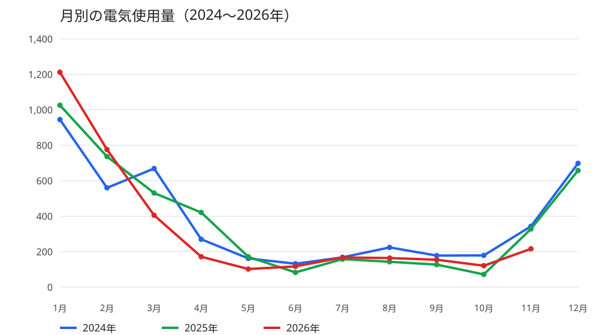
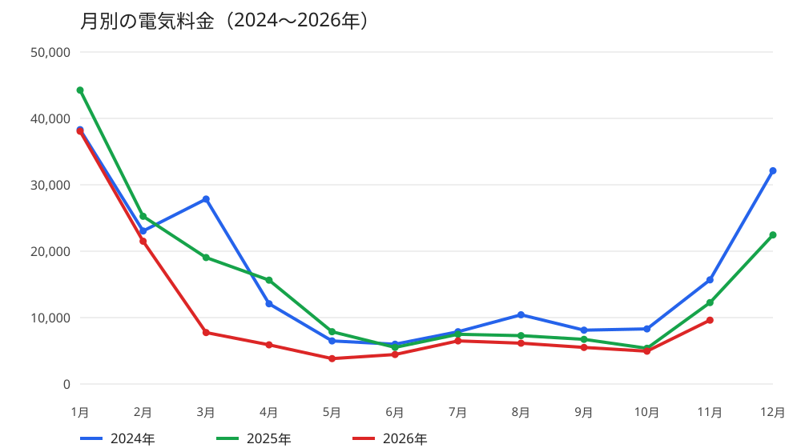

# 直チャット保存要求

## 保存対象種別
会話記録

## 本文

# 20261127-5

**User:** Anonymous  
**Created:** 11/27/2026 10:11:12  
**Updated:** 11/27/2026 10:47:20  
**Exported:** 11/28/2026 11:12:35  
**Link:** [https://chatgpt.com/c/6b08d8ae-7940-83ec-8c92-728cbdb422d5](https://chatgpt.com/c/6b08d8ae-7940-83ec-8c92-728cbdb422d5)  

## Prompt:
2026/11/27 10:09:31

もうつくったじゃん

## Prompt:
2026/11/27 10:11:28

ここに出したら、コピペする

## Response:
2026/11/27 10:11:39 · gpt-6-mini

> **取得した資料を要約しNote記事原稿を完成ibi**
>
> 
>
> 28s考えました

わかった、たか。noteに貼り付けられる形で、ここに完成原稿を出す。

Pagesはもう作成済みなんだね。そこを未着手と扱ったのは、こちらの確認不足だった。余計な工程には戻らず、BLOG-0008のnote掲載用原稿を整える。以下がnote掲載用の原稿だ。本文はGitHubのBLOG-0008原稿をベースにしている。グラフはnote側で画像をアップロードして、指定位置に挿入してほしい。

**document: **

# 丸得情報・第1回｜卒FIT後、パワコン故障を機に蓄電池を導入。電力会社も見直した

## 太陽光発電を導入してから、卒FITまで

我が家に太陽光発電を設置したのは2010年12月。容量は3.22kWだった。

その後、FIT期間を終えた。卒FITを迎えたころは電気料金の高騰もあり、太陽光発電の恩恵をありがたく感じていた。

ところが、2024年11月にパワーコンディショナーが故障。業者に見てもらったところ、パワコンがだめになったとのことだった。

## パワコン交換ではなく、蓄電池を導入することに

パワコンだけを交換する場合、費用は50万〜60万円くらい。そこで、パワコンを交換するだけでなく、パワコン内蔵の蓄電池を導入する方向に考えを切り替えた。

蓄電池の導入費用は約100万円。安い買い物ではないが、パワコン交換だけで済ませるより、蓄電池も使えるようにした方がよいと考えた。

長州産業の蓄電池が稼働を始めたのは2025年2月だ。

## 電力会社も、その時々で見直してきた

蓄電池の導入と前後して、電力会社も見直してきた。

- 2024年：東北電力
- 2025年2月：シン・エナジー
- 2026年2月：リボンエナジー
- 2026年11月：オクトパスエナジー

シン・エナジーに変更したのは、その時点で安くなると判断したからだ。リボンエナジーに変更したときも、その時点で一番安くなると思った。

リボンエナジーは基本料金がない。一方で、電気を使った時間帯のJEPXの市場価格に21円/kWhが上乗せされる仕組みだ。JEPXの単価は0円のこともあれば、50円を超えることもある。市場価格によって電気料金が大きく変わる。

ただ、電気を多く使う冬は、価格の変動が気になる。そこで2026年11月、オクトパスエナジーへ切り替えた。

現在の契約は「オール電化オクトパスサンシャイン」。料金は次のとおりだ。

| 時間帯 | 単価 |
|---|---:|
| デイタイム（9:00〜15:00） | 16.85円/kWh |
| スタンダードタイム（0:00〜9:00、15:00〜24:00） | 26.07円/kWh |

基本料金は、10kWまで1日160.56円。

固定された時間帯別の料金なので、JEPXの市場価格に連動するプランより、冬場の見通しを立てやすいと感じている。

## 冬は電気の使用量が増える

我が家で電気を多く使うのは12月から2月。主な用途はエアコン暖房とエコキュートだ。

冬は雪の影響で太陽光発電量も大きく落ちる。春から秋なら、日照のある時間帯に蓄電する運用もしやすいが、冬はそうはいかない。

現在は、比較的安い9時から15時の時間帯に電力会社から蓄電し、それ以外の時間帯に蓄電池を使う運用をしている。具体的な操作方法や設定については、別の記事で紹介したい。

## 電気使用量と電気料金の推移

月ごとの電気使用量と請求額を、2024年から2026年まで並べてみた。

【ここに「月別の電気使用量」のグラフを挿入】

【ここに「月別の電気料金」のグラフを挿入】

冬に使用量と請求額が大きくなり、春から秋にかけて下がる傾向が見て取れる。ただし、この期間には蓄電池の導入だけでなく、電力会社や料金プランの変更も含まれている。グラフだけで、蓄電池による節約効果を単独で判断することはできない。

## これから

卒FIT後のパワコン故障をきっかけに、蓄電池を導入し、電力会社もその時々の状況に合わせて見直してきた。

電力会社については、今後も季節や料金を見ながら考えていくつもりだ。冬以外はリボンエナジーに戻すことも選択肢にしているが、その時点の価格を見て判断したい。

次の記事では、蓄電池の操作方法や充電・放電の設定、実際の使い方について書いてみたい。

**グラフは2点**、GitHubの `images/denki_usage.svg` と `images/denki_bills.svg` が元データだ。noteに貼る際は、画像としてアップロードして差し込んでほしい。

## Prompt:
2026/11/27 10:12:42

グラフ、組み込めないのか

## Response:
2026/11/27 10:12:53 · gpt-6-mini

> ****
>
> 
>
> **確認したSVGとGitHub画像のMarkdown埋め込み可否**
>
> 
>
> 33s考えました

組み込めるよ、たか。さっきは画像の挿入位置を示すだけにしてしまった。ごめん。

GitHubに保存されているSVGを直接参照する形に直せる。原稿内のグラフ部分を、次のようにする。

- 月別の電気使用量：
  
  
- 月別の電気料金：
  
  

ただし、noteへの貼り付け時に外部SVGが画像として取り込まれるかは、note側の仕様次第。確実に画像として貼れるPNG版も用意できる。本文にグラフを組み込んだ完成稿にして出し直すよ。

## Prompt:
2026/11/27 10:13:54

はよだせ

## Response:
2026/11/27 10:13:55 · gpt-6-mini

たか、グラフを組み込んだnote掲載用の完成稿を出す。グラフはGitHub上の原本を直接参照する形にしてある。以下をそのままコピーして使ってほしい。

**document: **

# 丸得情報・第1回｜卒FIT後、パワコン故障を機に蓄電池を導入。電力会社も見直した

## 太陽光発電を導入してから、卒FITまで

我が家に太陽光発電を設置したのは2010年12月。容量は3.22kWだった。

その後、FIT期間を終えた。卒FITを迎えたころは電気料金の高騰もあり、太陽光発電の恩恵をありがたく感じていた。

ところが、2024年11月にパワーコンディショナーが故障。業者に見てもらったところ、パワコンがだめになったとのことだった。

## パワコン交換ではなく、蓄電池を導入することに

パワコンだけを交換する場合、費用は50万〜60万円くらい。そこで、パワコンを交換するだけでなく、パワコン内蔵の蓄電池を導入する方向に考えを切り替えた。

蓄電池の導入費用は約100万円。安い買い物ではないが、パワコン交換だけで済ませるより、蓄電池も使えるようにした方がよいと考えた。

長州産業の蓄電池が稼働を始めたのは2025年2月だ。

## 電力会社も、その時々で見直してきた

蓄電池の導入と前後して、電力会社も見直してきた。

- 2024年：東北電力
- 2025年2月：シン・エナジー
- 2026年2月：リボンエナジー
- 2026年11月：オクトパスエナジー

シン・エナジーに変更したのは、その時点で安くなると判断したからだ。リボンエナジーに変更したときも、その時点で一番安くなると思った。

リボンエナジーは基本料金がない。一方で、電気を使った時間帯のJEPXの市場価格に21円/kWhが上乗せされる仕組みだ。JEPXの単価は0円のこともあれば、50円を超えることもある。市場価格によって電気料金が大きく変わる。

ただ、電気を多く使う冬は、価格の変動が気になる。そこで2026年11月、オクトパスエナジーへ切り替えた。

現在の契約は「オール電化オクトパスサンシャイン」。料金は次のとおりだ。

| 時間帯 | 単価 |
|---|---:|
| デイタイム（9:00〜15:00） | 16.85円/kWh |
| スタンダードタイム（0:00〜9:00、15:00〜24:00） | 26.07円/kWh |

基本料金は、10kWまで1日160.56円。

固定された時間帯別の料金なので、JEPXの市場価格に連動するプランより、冬場の見通しを立てやすいと感じている。

## 冬は電気の使用量が増える

我が家で電気を多く使うのは12月から2月。主な用途はエアコン暖房とエコキュートだ。

冬は雪の影響で太陽光発電量も大きく落ちる。春から秋なら、日照のある時間帯に蓄電する運用もしやすいが、冬はそうはいかない。

現在は、比較的安い9時から15時の時間帯に電力会社から蓄電し、それ以外の時間帯に蓄電池を使う運用をしている。具体的な操作方法や設定については、別の記事で紹介したい。

## 電気使用量と電気料金の推移

月ごとの電気使用量と請求額を、2024年から2026年まで並べてみた。

### 月別の電気使用量


### 月別の電気料金


冬に使用量と請求額が大きくなり、春から秋にかけて下がる傾向が見て取れる。ただし、この期間には蓄電池の導入だけでなく、電力会社や料金プランの変更も含まれている。グラフだけで、蓄電池による節約効果を単独で判断することはできない。

## これから

卒FIT後のパワコン故障をきっかけに、蓄電池を導入し、電力会社もその時々の状況に合わせて見直してきた。

電力会社については、今後も季節や料金を見ながら考えていくつもりだ。冬以外はリボンエナジーに戻すことも選択肢にしているが、その時点の価格を見て判断したい。

次の記事では、蓄電池の操作方法や充電・放電の設定、実際の使い方について書いてみたい。

※noteが外部SVGを表示しない場合は、画像URLを直接開いて画像を保存し、noteの画像挿入機能からアップロードしてほしい。本文のグラフ位置はこのままでいい。

## Prompt:
2026/11/27 10:14:50

出てないように見えるが？

## Response:
2026/11/27 10:14:52 · gpt-6-mini

そのとおり。ごめん、たか。前の回答はグラフの画像そのものを表示したのではなく、画像へのリンクを本文に入れただけだった。

**ここにグラフを表示するには、SVGをPNGに変換して画像として用意する必要がある。** いまの回答では、まだグラフ画像は表示できていない。

## Prompt:
2026/11/27 10:15:45

どないすんねん

## Response:
2026/11/27 10:15:54 · gpt-6-mini

> **取得したSVG画像と電気料金請求書画像**
>
> 
>
> **ウェブを検索中**
>
> 
>
> 20s考えました

たか、こちらでやることは決まった。**GitHubにある2つのグラフをPNG画像に変換し、noteに貼り付けられる形にする。** SVGのリンクを本文に書くだけでは、note上に画像として表示される保証がない。そこを先に片づける。

手順はこれでいこう。

1. [raw.githubusercontent.com](https://raw.githubusercontent.com/takalenny-blip/ai-project/main/docs/%E4%BC%81%E7%94%BB/BLOG-0008/images/denki_usage.svg?utm_source=chatgpt.com) を開く。
2. 画像を右クリックして保存する。
3. [raw.githubusercontent.com](https://raw.githubusercontent.com/takalenny-blip/ai-project/main/docs/%E4%BC%81%E7%94%BB/BLOG-0008/images/denki_bills.svg?utm_source=chatgpt.com) も同じように保存する。
4. noteの編集画面で、本文の「月別の電気使用量」「月別の電気料金」の位置に、それぞれ画像をアップロードする。

本文は前に出した原稿を使い、画像リンクの記述だけは貼らなくていい。

**こちらでPNGファイルを作って渡すところまでできていない。** そこをできたように言うのはやめておく。まずは既存グラフを使うこの方法なら、グラフの内容を作り直さずにnoteへ載せられる。

## Prompt:
2026/11/27 10:36:33

ん？最後の、noteリンクは？

## Response:
2026/11/27 10:36:39 · gpt-6-mini

あっ、最後の「いつものnote記事へのリンク」を落としてしまった。ごめん、たか。

記事の末尾に、これを戻す。

**standard: **

## もっと深く楽しみたい方へ

AIとの協働をもっと深めたい方は、こちらの記事もご覧いただきたい。

[AIと一緒に作る！自分専用のAI作業環境構築ガイド（note）](https://note.com/gifted_iris4353/n/n51d89ed6146c)

これが記事の最後に入る形だ。

## Prompt:
2026/11/27 10:39:11

公開した

## Response:
2026/11/27 10:39:21 · gpt-6-mini

公開完了だね！たか、お疲れさま。

これで「丸得情報」第1回、note版も公開だ。GitHub Pages版に続いて、note版まで完了。次の記事は、蓄電池の操作方法や充電・放電の設定、実際の使い方だね。

## Prompt:
2026/11/27 10:41:35

この状況で、ボード更新しよう。コピペできるようtsvでだして。列構成確認して

## Response:
2026/11/27 10:41:42 · gpt-6-mini

> ****
>
> 
>
> **取得したREADMEとファイルを確認しDropbox検索を実行**
>
> 
>
> **列構成を確認中**
>
> Excelの実際の列順と既存行を確認し、ブログ記事「丸得情報」に対応する更新内容を整理しています。既存IDとの重複を避け、ボードへ貼り付けやすいTSV形式に整えます。
>
> **列構成を確認した**
>
> 
>
> **Dropboxを検索しExcelファイルを取得、内容とシート構成を確認**
>
> 
>
> **列構成を再確認中**
>
> 完了済みとして登録する場合は、「完了」シートの12列（完了日を含む）を使う必要があります。既存IDとの重複を避け、記事公開と確認済み事実を反映したTSVに整えます。
>
> **列構成を再確認した**
>
> 
>
> 2m 8s考えました

ボードを確認した。シートは「作業一覧」「運用ルール」の2つ。今回使う「作業一覧」の列構成は、次の12列だ。

`番号 → 作業項目 → 領域 → 状態 → 優先度（1〜5） → 目的・完了条件 → 確認済み事実／保留事項 → 次のアクション → 制約・判断待ち → 完了証拠 → 最終確認日 → 完了日`

この順番・列数に合わせてTSVを作る。

ごめん、列数の訂正がある。確認したところ、**「作業一覧」は11列、「完了」シートは12列**だった。

今回はGitHub Pages版とnote版の公開が完了しているので、「完了」シートに追加するTSVを出す。番号は既存の最大番号33の次の未使用番号34とした。

**「完了」シートの12列に対応したTSV**

```tsv
34	BLOG-0008 丸得情報・第1回の制作・公開	ブログ・note発信	完了	3	卒FIT後の蓄電池導入と電力会社の見直しについて、実体験を記事化し、GitHub Pagesとnoteで公開する。	本文の作成・修正完了。月別の電気使用量・電気料金グラフを掲載。GitHub Pages版は作成・確認済み。note版は2026年11月27日に公開。	公開完了。今後は必要に応じて修正する。蓄電池の操作方法・充放電設定は別記事で扱う。	実体験と確認済みの数値に基づいて記述する。グラフだけで蓄電池の節約効果を断定しない。蓄電池の具体的な操作方法は別記事とする。	本文原稿：docs/企画/BLOG-0008/BLOG-0008_本文_作業稿.md。グラフ：images/denki_usage.svg、images/denki_bills.svg。記事パーマリンク：marutoku-001-solar-battery-after-fit。GitHub Pages版の作成・確認、note版の公開（2026-11-27、たか確認）。	2026-11-27	2026-11-27
```

この1行を「完了」シートの最終行に貼り付ければよい。ボード自体は変更していない。

## Prompt:
2026/11/27 10:45:48

なんじゃこれ？２５じゃないの？

## Response:
2026/11/27 10:45:49 · gpt-6-mini

そのとおり。既存の作業番号25「AI対話型の体験発信プロジェクト」の進捗更新だ。新しい番号34を作る話ではなかった。こちらの判断ミスだ。ごめん。

番号25の行を、今回の完了内容を反映して更新するTSVを出し直す。

```tsv
25	AI対話型の体験発信プロジェクト	ブログ・note発信	進行中	3	映画・音楽・マンガ・アニメ・ドラマ・TV番組の感想や、蓄電池アプリなどの日常の実体験を、AIの質問で掘り下げ、本人らしい記事にして発信できる方法を確立する。無料で始められる範囲を基本とする。	映画の感想をAIの質問で引き出す方式に加え、音楽紹介記事の制作を試行。ストリート・スライダーズを題材にした記事は制作中。蓄電池の実体験を扱う「丸得情報」第1回「卒FIT後、パワコン故障を機に蓄電池を導入。電力会社も見直した」を制作。GitHub Pages版を作成・確認し、note版も2026年11月27日に公開。月別の電気使用量・電気料金グラフを掲載。	次の記事として、蓄電池の操作方法、充電・放電の設定、実際の使い方を記事化する。	本人が実際に感じたこと・経験したことを中心にする。感想や体験を捏造しない。商品情報・価格・リンク先を確認する。記事の公開はたかが判断する。	丸得情報第1回のGitHub Pages版・note版公開。グラフ2点（denki_usage.svg、denki_bills.svg）。	2026-11-27
```

**番号25の既存行と差し替え**。状態はプロジェクト全体が継続中なので「進行中」のままだ。

## Prompt:
2026/11/27 10:47:11

手間のかかる

## Response:
2026/11/27 10:47:14 · gpt-6-mini

ほんとに余計な手間をかけさせた。ごめん、たか。

今回は既存の25番を更新するだけでよかった。最初からそう判断すべきだった。次からはボードの既存項目との対応を確認してから、更新用TSVを一度で出す。


---
Powered by [ChatGPT Exporter](https://www.chatgptexporter.com)
