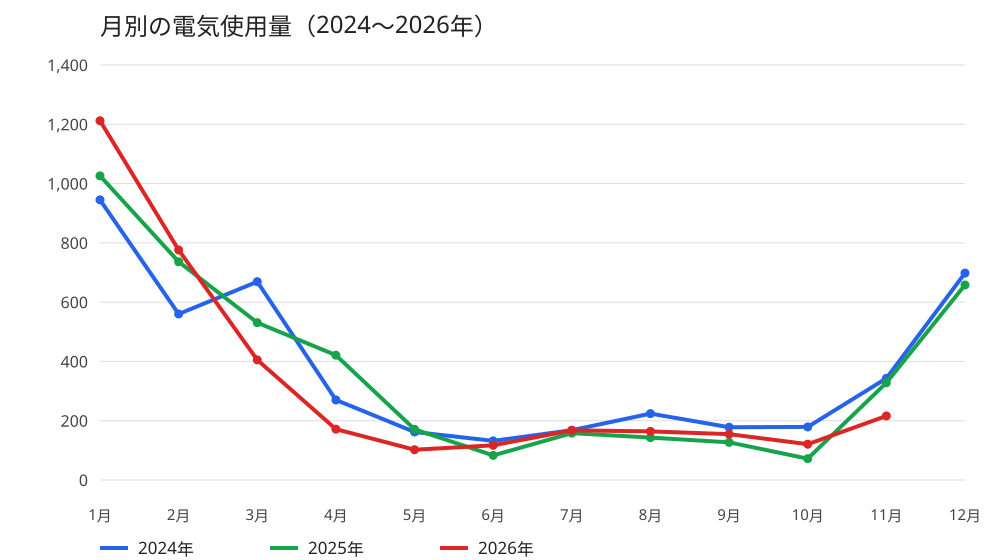
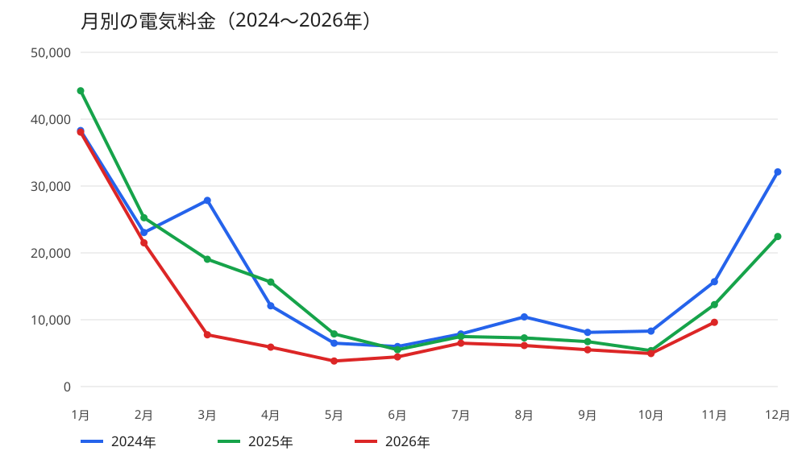

# 丸得情報・第1回｜卒FIT後、パワコン故障を機に蓄電池を導入。電力会社も見直した

## 太陽光発電を導入してから、卒FITまで

我が家に太陽光発電を設置したのは2010年12月。容量は3.22kWだった。

その後、FIT期間を終えた。卒FITを迎えたころは電気料金の高騰もあり、太陽光発電の恩恵をありがたく感じていた。

ところが、2024年11月にパワーコンディショナーが故障。業者に見てもらったところ、パワコンがだめになったとのことだった。

## パワコン交換ではなく、蓄電池を導入することに

パワコンだけを交換する場合、費用は50万〜60万円くらい。そこで、パワコンを交換するだけでなく、パワコン内蔵の蓄電池を導入する方向に考えを切り替えた。

蓄電池の導入費用は約100万円。安い買い物ではないが、パワコン交換だけで済ませるより、蓄電池も使えるようにした方がよいと考えた。

長州産業の蓄電池が稼働を始めたのは2025年2月だ。

## 電力会社も、その時々で見直してきた

蓄電池の導入と前後して、電力会社も見直してきた。

- 2024年：東北電力
- 2025年2月：シン・エナジー
- 2026年2月：リボンエナジー
- 2026年11月：オクトパスエナジー

シン・エナジーに変更したのは、その時点で安くなると判断したからだ。リボンエナジーに変更したときも、その時点で一番安くなると思った。

リボンエナジーは基本料金がない。一方で、電気を使った時間帯のJEPXの市場価格に21円/kWhが上乗せされる仕組みだ。JEPXの単価は0円のこともあれば、50円を超えることもある。市場価格によって電気料金が大きく変わる。

ただ、電気を多く使う冬は、価格の変動が気になる。そこで2026年11月、オクトパスエナジーへ切り替えた。

現在の契約は「オール電化オクトパスサンシャイン」。料金は次のとおりだ。

| 時間帯 | 単価 |
|---|---:|
| デイタイム（9:00〜15:00） | 16.85円/kWh |
| スタンダードタイム（0:00〜9:00、15:00〜24:00） | 26.07円/kWh |

基本料金は、10kWまで1日160.56円。

固定された時間帯別の料金なので、JEPXの市場価格に連動するプランより、冬場の見通しを立てやすいと感じている。

## 冬は電気の使用量が増える

我が家で電気を多く使うのは12月から2月。主な用途はエアコン暖房とエコキュートだ。

冬は雪の影響で太陽光発電量も大きく落ちる。春から秋なら、日照のある時間帯に蓄電する運用もしやすいが、冬はそうはいかない。

現在は、比較的安い9時から15時の時間帯に電力会社から蓄電し、それ以外の時間帯に蓄電池を使う運用をしている。具体的な操作方法や設定については、別の記事で紹介したい。

## 電気使用量と電気料金の推移

月ごとの電気使用量と請求額を、2024年から2026年まで並べてみた。

冬に使用量と請求額が大きくなり、春から秋にかけて下がる傾向が見て取れる。ただし、この期間には蓄電池の導入だけでなく、電力会社や料金プランの変更も含まれている。グラフだけで、蓄電池による節約効果を単独で判断することはできない。

## これから

卒FIT後のパワコン故障をきっかけに、蓄電池を導入し、電力会社もその時々の状況に合わせて見直してきた。

電力会社については、今後も季節や料金を見ながら考えていくつもりだ。冬以外はリボンエナジーに戻すことも選択肢にしているが、その時点の価格を見て判断したい。

次の記事では、蓄電池の操作方法や充電・放電の設定、実際の使い方について書いてみたい。
